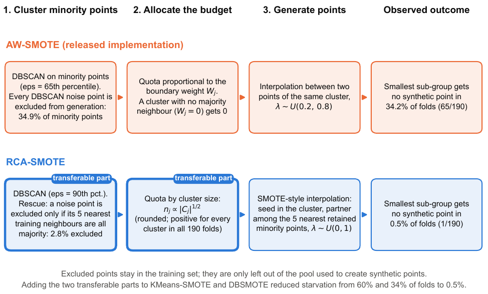

# RCA-SMOTE

### Mitigating Rare Minority Subgroup Starvation in Cluster-Based Oversampling

[](#installation)
[](LICENSE)

Research code, main-paper results, figures, and LaTeX sources for **RCA-SMOTE**, a rare-cluster-aware correction to cluster-based oversampling.

**Authors:** Divya Yadav · Mayankkumar Rathva · Pratipalsinh Jadeja 

[Read the paper](paper/RCA_SMOTE_Final.pdf) · [Final result tables](results/main_tables/) · [Figures](figures/) · [Reproduction guide](docs/reproduction_instructions.md) · [Citation](CITATION.cff)

## Overview

A minority class can contain several subgroups with very different sizes. A classifier may perform well on the largest subgroup while missing a smaller one. Aggregate metrics can make that failure difficult to see.

Cluster-based oversamplers attempt to preserve this internal structure, but two operations can leave rare subgroups without synthetic support:

1. **Exclusion during clustering:** sparse minority observations can be classified as DBSCAN noise and excluded from generation.
2. **Zero allocation:** a retained cluster can receive no synthetic samples when allocation depends on its proximity to the majority class.

This project measures **subgroup starvation** and studies RCA-SMOTE's changes to clustering, sparse-point rescue, quota allocation, and sample generation. It includes comparisons with AW-SMOTE, standard SMOTE, and other resampling methods, together with ablation and transfer experiments.

## RCA-SMOTE at a glance

The frozen configuration follows four steps:

| Step | Operation |
|---|---|
| **Minority clustering** | Apply DBSCAN with `MinPts = 2` and a radius based on the 90th percentile of nearest-minority distances. |
| **Sparse-point rescue** | Exclude a DBSCAN-noise observation from generation only when all five neighbours used by the rescue test are majority observations. Other sparse points can join retained clusters or form microclusters. |
| **Size-based allocation** | Allocate the synthetic budget in proportion to the square root of retained cluster size, using the frozen rounding and residual rule. |
| **Synthetic generation** | Spread seeds across cluster members and interpolate towards one of the five nearest retained minority observations, using a coefficient sampled uniformly from `[0, 1)`. |

The implementation is the selected **V7** configuration. Parameters and algorithm arithmetic were preserved during repository assembly. The quota rule has **no universal minimum-allocation guarantee**, and rescue does not guarantee representation of every true subgroup.



The equations, edge cases, and Algorithm 1 are described in the [main paper](paper/RCA_SMOTE_Final.pdf). See [methodology](docs/methodology.md) and [limitations](docs/limitations.md) for implementation notes.

## Final reported results

The tables below summarize the final manuscript's updated RCA-SMOTE measurements. Complete comparisons with all 16 configurations are available in the linked CSVs.

### Group A-main: 19 subgroup-aware datasets

| Method | wBA | Smallest-subgroup recall | G-mean | F1 | MCC | Precision | Specificity |
|---|---:|---:|---:|---:|---:|---:|---:|
| **RCA-SMOTE** | **0.853** | **0.674** | **0.861** | **0.759** | **0.719** | **0.744** | **0.936** |
| SMOTE | 0.849 | 0.641 | 0.861 | 0.752 | 0.709 | 0.724 | 0.932 |
| AW-SMOTE | 0.822 | 0.556 | 0.830 | 0.733 | 0.691 | 0.743 | 0.949 |

Bold identifies the proposed method; it does not indicate a significance test or the best value across all methods.

[Complete Table 2](results/main_tables/table2_groupA_final.csv)

### Group B: 27 standard binary benchmarks

| Method | G-mean | MCC | F1 | ROC-AUC | Average precision | Recall | Specificity |
|---|---:|---:|---:|---:|---:|---:|---:|
| **RCA-SMOTE** | **0.693** | **0.457** | **0.502** | **0.817** | **0.474** | **0.588** | **0.914** |
| SMOTE | 0.680 | 0.440 | 0.485 | 0.815 | 0.464 | 0.574 | 0.912 |
| AW-SMOTE | 0.624 | 0.420 | 0.465 | 0.799 | 0.452 | 0.502 | 0.927 |

[Complete Table 3](results/main_tables/table3_groupB_final.csv)

These compact comparisons do not omit stronger methods from the full results. For example, the complete Group A table includes SMOTETomek's G-mean of `0.862`, and the Group B table includes random undersampling's G-mean of `0.763`. Methods differ in their recall, precision, specificity, and subgroup trade-offs.

### Result provenance and interpretation

The updated Table 2/3 means were supplied as final aggregate measurements and exported from the final manuscript. **Their producing code revision, environment, and updated per-fold predictions/results are not available in this repository.** The existing experiment runners therefore do not establish an end-to-end reproduction of those updated means.

Comparator rows, historical mean ranks, and the main paper's statistical, ablation, sensitivity, transfer, and validity analyses use the documented earlier supporting run. The historical rank column in Table 2 is labelled accordingly. Those tests were not recomputed for the updated aggregate means.

Higher mean scores alone do not establish significant or universal superiority over standard SMOTE. Read [result provenance](docs/result_provenance.md) and [the result manifest](results/result_manifest.json) before combining results from different experiments.

## Subgroup starvation and supporting findings

In the **earlier supporting experiment** on 190 Group A-main training folds:

| Method | Folds starving the smallest subgroup | Starvation rate |
|---|---:|---:|
| AW-SMOTE | 65 / 190 | 34.2% |
| RCA-SMOTE | 1 / 190 | 0.5% |
| SMOTE | 0 / 190 | 0.0% |

A synthetic point is attributed to the subgroup of its nearest original minority observation. This is an attribution proxy, not identification of the point's actual generating parent. A subgroup is counted as starved when it receives no attributed synthetic point in the training fold.

The supporting experiments also examine:

- **Ablation:** replacing individual components and reverting all four components.
- **Sensitivity:** varying the radius percentile, quota exponent, and neighbour counts.
- **Transfer:** adding rescue and quota mechanisms to KMeans-SMOTE and DBSMOTE, including their precision costs.
- **Evaluation trade-offs:** comparing subgroup recall with aggregate classification metrics.
- **Baseline reconstruction:** studying AW-SMOTE's released implementation under a separate five-fold protocol.

These analyses remain included because they support claims in the **main paper**. Supplementary documents and expanded supplementary presentation tables are excluded.

## Repository structure

```text
RCA_SMOTE/
├── README.md
├── LICENSE
├── CITATION.cff
├── requirements.txt
├── requirements-stage4.txt
├── PROJECT_STRUCTURE.txt
├── code/                   # Frozen sampler, shared helpers and experiments
│   ├── rca_smote.py
│   ├── improved.py
│   ├── rc_aw_smote.py
│   ├── common.py
│   ├── stage3_datasets.py
│   ├── stage4_common.py
│   ├── cluster_plugins.py
│   ├── exp*.py
│   ├── scripts/            # Baseline and dataset acquisition
│   └── verification/       # Main-paper checks and AW reconstruction code
├── analysis/               # Table exports and dataset-block reaggregation
├── plotting/               # Sources for the eight main-paper figures
├── results/
│   ├── main_tables/        # Tables 1–7; updated Table 2/3 summaries only
│   └── supporting/         # Clearly identified earlier supporting evidence
├── figures/                # Canonical vector PDFs
│   └── previews/           # PNG previews
├── paper/                  # Main LaTeX, bibliography, Elsevier files and PDF
├── data/                   # Dataset descriptions, selection rules and hashes
├── reproducibility/        # Protocols, manifests and environment records
├── docs/                   # Methodology, provenance, limitations and instructions
├── scripts/                # Portable launcher, paper builder and release checks
└── tests/                  # Bounded sampler and metric fixtures
```

The repository includes **40 selected original Python source files**, plus release helpers. Some shared files also contain broader historical analyses; use the documented entry points below. See the [actual file tree](PROJECT_STRUCTURE.txt) and [code-source guide](docs/code_sources.md).

## Installation

The supplied core requirements target **Python 3.10**, the environment used for the independent reconstruction and bounded release checks. They are not a claim about the unavailable environment of the updated aggregate measurements.

Clone the repository with LF line endings so the recorded file hashes remain consistent:

```powershell
git clone --config core.autocrlf=false --config core.eol=lf https://github.com/Divya00005/RCA_SMOTE.git
cd RCA_SMOTE
```

Create and activate a Python 3.10 environment on Windows:

```powershell
py -3.10 -m venv .venv
.\.venv\Scripts\Activate.ps1
python -m pip install -r requirements.txt
```

On Linux or macOS:

```bash
python3.10 -m venv .venv
source .venv/bin/activate
python -m pip install -r requirements.txt
```

For the Stage-4 cluster methods, install the additional pinned packages after the core requirements:

```bash
python -m pip install --no-deps -r requirements-stage4.txt
```

All commands below assume an activated environment and the repository root as the working directory. If PowerShell activation is unavailable, invoke `.\.venv\Scripts\python.exe` in place of `python`.

### Fetch the pinned AW-SMOTE baseline

The current RCA-SMOTE dependency chain imports the upstream AW-SMOTE base class. Fetch it before importing the sampler:

```bash
python code/scripts/fetch_baseline.py
```

The downloader uses commit `f0dc14807e02292a096e261ca9af21b0d1300753` and verifies SHA-256:

```text
72c3d438093538d0c5c3d19bc5dc456be9cdc743a7b907bfec5abd2591d15124
```

The downloaded code is stored under `.cache/aw_baseline/`, which is ignored by Git. An already downloaded file can be supplied with `--from-file PATH`; the same hash check applies.

Upstream reference: [AW-SMOTE authors' repository](https://github.com/guo-source-1/AWSMOTE) and [original article](https://doi.org/10.3390/math14173238).

## Quick example

The following example shows training-only scaling and resampling. The test observations are transformed with the training scaler and remain unresampled.

```python
import sys
from collections import Counter
from pathlib import Path

from sklearn.datasets import make_classification
from sklearn.model_selection import train_test_split
from sklearn.preprocessing import StandardScaler

sys.path.insert(0, str(Path("code").resolve()))
from rca_smote import RCASMOTE

X, y = make_classification(
    n_samples=400,
    n_features=6,
    n_informative=4,
    n_redundant=0,
    weights=[0.90, 0.10],
    random_state=42,
)

X_train, X_test, y_train, y_test = train_test_split(
    X, y, test_size=0.25, stratify=y, random_state=42
)

scaler = StandardScaler().fit(X_train)
X_train_scaled = scaler.transform(X_train)
X_test_scaled = scaler.transform(X_test)

sampler = RCASMOTE(random_state=42)
X_resampled, y_resampled = sampler.fit_resample(X_train_scaled, y_train)

print("Training counts:", Counter(y_train))
print("Resampled counts:", Counter(y_resampled))
# Fit a classifier using X_resampled/y_resampled.
# Evaluate using the untouched X_test_scaled/y_test.
```

The implementation supports binary numerical problems and treats the smaller class as the minority. Training-fold preprocessing must be completed before resampling. Do not scale or oversample the complete dataset before splitting it for valid evaluation.

## Datasets and evaluation

The study includes **51 datasets/tasks**:

| Cohort | Datasets | Role |
|---|---:|---|
| Group A development | 5 | Method selection; reported separately |
| Group A-main | 19 | Subgroup-aware evaluation: 10 previously used held-out datasets and 9 new datasets |
| Group B | 27 | Standard binary benchmarks: 13 AW-SMOTE KEEL datasets, 8 additional KEEL datasets and 6 imbalanced-learn datasets |

Group A subgroups are constructed by regrouping original classes with imposed subgroup sizes. Subgroup labels are available to evaluation code, not supplied as extra labels to the oversampler or classifier.

The supporting benchmark uses five repetitions of two-fold cross-validation, with scaling and resampling fitted on training folds. Group A splits are stratified by subgroup; Group B splits are stratified by class. The classifiers are SVM, kNN, decision tree and random forest; ensemble comparisons are handled separately. The AW-SMOTE reconstruction uses a distinct five-fold protocol.

Fold metrics are averaged within each dataset/classifier/method, then equally across classifiers. Statistical tests use **datasets as blocks**, not correlated dataset–classifier pairs as independent observations. The exact aggregation order is preserved because floating-point ties can affect signed-rank tests.

### Main metrics

- **wBA:** half weight on majority specificity and half equally across minority subgroup recalls: `0.5 × (specificity + mean subgroup recall)`.
- **Smallest-subgroup recall:** recall for the subgroup smallest by construction, not the subgroup with the lowest observed recall.
- **G-mean:** geometric mean of minority recall and majority specificity.
- **F1, MCC, precision and specificity:** reported together to expose detection/false-positive trade-offs.
- **ROC-AUC:** computed from continuous decision scores or probabilities in the supporting benchmark; the AW reconstruction uses minority-class probabilities.
- **PR-AUC:** implemented as average precision.

Full definitions and the declared statistical comparison families are in the paper.

### Obtain the data

```bash
python scripts/run.py code/scripts/fetch_data.py
```

The script obtains PMLB, OpenML and imbalanced-learn inputs and prints links for the KEEL ZIPs. Save those KEEL files under `data/raw/keel/` as instructed. Raw datasets and caches are not bundled with the repository.

See [dataset selection and sources](data/DATASETS.md), the [dataset inventory](data/datasets.csv), and [data instructions](data/README.md).

## Verify the repository

Check paper assets, final table values, selected source presence, syntax and recorded file hashes:

```bash
python scripts/check_release.py
```

This check uses the Python standard library. After installing dependencies and fetching the baseline, run the bounded sampler/metric fixtures:

```bash
python scripts/run.py tests/test_sampler_and_metrics.py
```

Assembly checks included:

- Five fixed-seed sampler outputs matching the original implementation byte-for-byte.
- Two passing sampler/metric tests.
- Exact agreement for 120 checked supporting-run dataset-level comparisons, including Holm-adjusted p-values.
- Successful execution of the plotting entry points for all eight figure types.
- Hash agreement between the eight canonical figure PDFs and the final manuscript assets.

These checks verify the assembled release and selected supporting computations. They do not establish reproduction of the updated Table 2/3 aggregates. See the [verification report](docs/release_verification.md).

## Reproduce tables, figures and supporting analyses

Generated outputs belong under ignored `work/`; the canonical published tables and figures are preserved separately.

### Export displayed main-paper tables

```bash
python analysis/export_main_tables.py
```

Output: `work/exported_tables/`. This exports the values displayed in `paper/main.tex`; it does not estimate performance or run an experiment.

### Recompute supporting dataset-level tests

```bash
python analysis/recompute_statistics.py
```

Output: `work/recomputed_statistics/`. The script uses saved supporting folds, the folds-then-classifiers aggregation order, and 15-comparison Holm families. It does not test the updated aggregate means.

### Regenerate the main-paper figures

```bash
python scripts/run.py plotting/make_fig1_corrected.py
python scripts/run.py plotting/make_fig2.py
python scripts/run.py plotting/fig_ablation_analysis.py
python scripts/run.py plotting/make_updated_figures.py
```

Output: `work/generated_figures/`. The four commands produce all eight figure types without overwriting `figures/`.

| Figure | Content |
|---|---|
| 1 | RCA-SMOTE methodology and the mechanisms studied |
| 2 | Fixed-seed, two-dimensional AW-SMOTE/RCA-SMOTE illustration |
| 3 | Subgroup starvation and smallest-subgroup recall |
| 4 | Aggregate Group A-main comparison |
| 5 | Component ablation |
| 6 | Transfer to KMeans-SMOTE and DBSMOTE |
| 7 | Mean smallest-subgroup recall across configurations |
| 8 | Mean wBA across configurations |

Despite preserved filenames, Figure 4 is an aggregate comparison, Figure 7 is not the older subgroup-position curve, and Figure 8 is not a critical-difference diagram. Use the final captions to interpret them.

### Run the supporting experiments

After obtaining the inputs, these commands rerun the documented supporting protocols:

```bash
python scripts/run.py code/exp4_all_methods.py --jobs 2 --out work/benchmark_folds
python scripts/run.py code/exp5_ablation.py --jobs 2
python scripts/run.py code/exp6_cluster_audit.py --jobs 2
```

Full experiments can take substantial CPU time. Their outputs describe the supporting protocol; they must not be substituted for the final updated Table 2/3 measurements without the producing-run evidence.

### Reconstruct the AW-SMOTE baseline

The main paper's Section 8.3 has a separate preparation and evaluation workflow:

```bash
python scripts/run.py code/verification/aw_paper_replication/prepare_sources.py
python scripts/run.py code/verification/aw_paper_replication/run_replication.py --primary --jobs 2
```

The preparation helper checks the preserved dataset hashes. The existing runner's diagnostic modes include deliberately invalid pre-CV controls. Those controls investigate protocol differences and must never be presented as valid benchmark evaluations. The reconstruction does not establish how the original authors conducted their experiments.

Some original audit scripts depend on additional archival inputs. Their inclusion preserves relevant source and dependencies; it does not make every historical audit workflow a standalone release command. Consult the [reproduction guide](docs/reproduction_instructions.md) and [code-source guide](docs/code_sources.md).

## Build the paper

The main paper uses the Elsevier `elsarticle` class. Sources, bibliography, class/style files and the compiled PDF are under [`paper/`](paper/). Figures are referenced from `../figures/`.

With a suitable TeX installation and `latexmk`:

```bash
python scripts/build_paper.py
```

Alternatively, supply a Tectonic executable:

```bash
python scripts/build_paper.py --tectonic PATH_TO_TECTONIC
```

Build products go to `work/latex/`, and the resulting PDF is copied to `paper/RCA_SMOTE_Final.pdf`.

For Overleaf, upload the complete project, select **`paper/main.tex`** as the main document, and use **pdfLaTeX**. The included local PDF was built with Tectonic/XeTeX; a separate pdfLaTeX build was not performed during assembly, and pagination can differ by engine.

## Limitations

- Updated aggregate means lack their producing code revision, environment and fold records in this release.
- Subgroups are constructed and may behave differently from naturally occurring, overlapping subgroups.
- Earlier exposure, duplicate feature vectors and related source families constrain independence and generalization.
- The frozen quota rounding has no universal positive/nonnegative guarantee; seed ordering and duplicate-neighbour ties have known edge cases.
- Nearest-point attribution measures synthetic coverage indirectly.
- Transfer plug-ins change membership handling as well as rescue/quota, so their effects are not perfectly isolated interventions.
- Improved minority detection can reduce precision or specificity. Non-significance does not establish equivalence, and the results do not establish universal superiority.

Further details: [limitations](docs/limitations.md), [result provenance](docs/result_provenance.md), and the main paper's discussion.

## Citation

Use GitHub's **Cite this repository** option or the supplied [CITATION.cff](CITATION.cff). The accompanying manuscript contains the complete research description and references. No publication DOI is assigned to this project in this repository.

## License and third-party materials

Project-authored code is provided under the [MIT License](LICENSE). That licence does not extend to independently owned third-party code, datasets, or publisher materials. The pinned AW-SMOTE implementation is obtained through the download helper; datasets are obtained from their respective sources. Preserve applicable attribution and terms when reusing those materials.

## Contributing

Open an issue or a pull request for reproducibility problems, documentation corrections, or proposed improvements. Describe the input, environment and command needed to reproduce a problem.

Changes to the frozen algorithm, experimental protocol or reported results should be identified as a new version and evaluated separately. Do not silently replace the reference method or remove unfavorable outcomes. When changing tracked release files, update the relevant provenance and file-hash records through a reviewed change.
